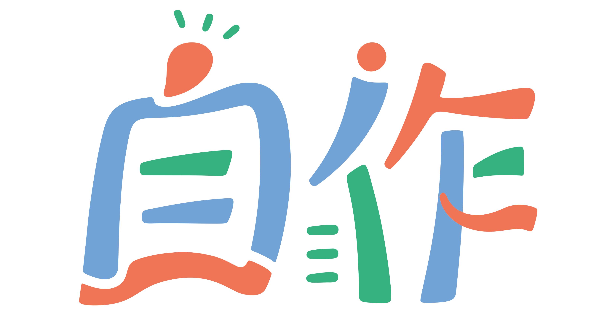
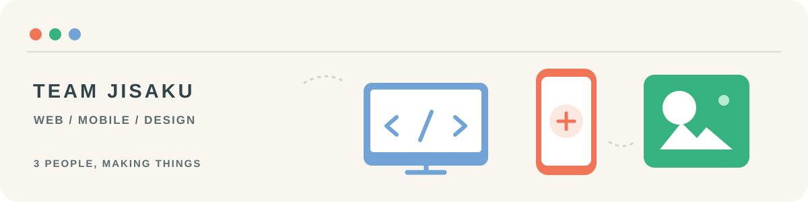

  

<h1 align="center">Team JISAKU</h1>

  デザイン、プロダクト設計、Web・モバイル開発に取り組む3人のチームです。 
  We are a team of three working across design, product planning, and web and mobile development.

  <a href="https://jisaku.dev/">日本語サイト</a> · <a href="https://jisaku.dev/en/">English website</a> · <a href="https://jisaku.dev/#contact">お問い合わせ / Contact</a>

## つくったもの / Selected work

- **[Mosimo Protocol](https://github.com/jphacks/sd_2607)** — ハッカソン作品。全国大会出場（Award Day Finalist）、Audience Award、三菱重工業航空機・飛翔体事業部 Sponsor Award。 / A hackathon project selected for the national competition (Award Day Finalist), and recipient of the Audience Award and Mitsubishi Heavy Industries Aircraft & Missile Systems Sponsor Award.
- **[QR GENERATOR.](https://qr.oriom.dev/)** — 千葉の個人開発。ブラウザで完結するQRコード生成ツールで、SVG出力やサイズ変更に対応。 / An individual project by Chiba: a browser-based QR code generator with SVG export and adjustable sizes.
- **リンクエム / Link M** — 解体工事事業部と美容事業部を持つ[株式会社リンクエム](https://www.linkm0403.com/)のホームページリニューアル。未公開。 / A website redesign for [Link M](https://www.linkm0403.com/), a company with demolition and beauty divisions. The redesign is not yet published.
- **[IFG Pathleader](https://play.google.com/store/apps/details?id=jp.ifg.pathleader)** — 磁気治療機器を操作するAndroidアプリ。デザインから実機テスト、リリースまで担当。 / An Android app for operating magnetic therapy equipment, from design through device testing and release.
- **[ドイツ相続法情報室 / German Inheritance Law Information](https://erb.tchiba.info/)** — ドイツの相続に関する法律と実務の情報サイト。 / A website about German inheritance law and practice.
- **とんペディア / Tompedia** — 東北大学の学生向け非公式アプリ。3人が開発に参加。 / An unofficial app for Tohoku University students, developed by all three members. [とんペディア_ラボ / Tompedia Lab](https://labo.tompedia.jp/) · [一般社団法人とんペディア / Tompedia](https://org.tompedia.jp/) · [Google Play](https://play.google.com/store/apps/details?id=jp.tompedia) · [App Store](https://apps.apple.com/jp/app/id6670725617)
- **[LENS](https://github.com/Lens-expand-your-horizons/LENS)** — Webアプリ。東北大学ビジネスアイデアコンテスト enspace賞。 / A web app that received the enspace Award at the Tohoku University Business Idea Contest.

実績やメンバーの詳細は[公式サイト](https://jisaku.dev/#work)をご覧ください。 / Explore our [work and team](https://jisaku.dev/en/#work) on our website.

## お問い合わせ / Get in touch

[お問い合わせフォーム / Contact form](https://jisaku.dev/#contact) · [info@jisaku.dev](mailto:info@jisaku.dev)
